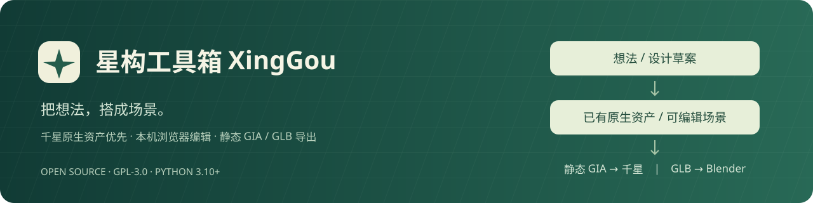
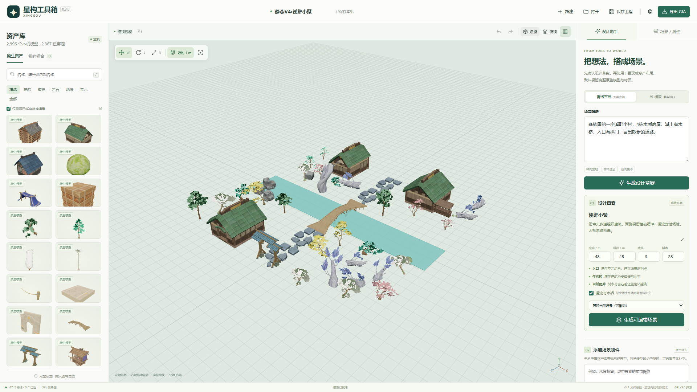

# 星构 StarScene Studio



在本机浏览器里，用千星奇域的现有原生资产设计场景，把文字想法转成可编辑布局，再导出 GIA 或带材质的 GLB。

**v0.1.4 · GPL-3.0 · Python 3.10+**

[](https://github.com/Crazyfourrrrrrrrrrr/starscene-studio/actions/workflows/tests.yml)

[下载最新版本](https://github.com/Crazyfourrrrrrrrrrr/starscene-studio/releases/latest) · [报告问题](https://github.com/Crazyfourrrrrrrrrrr/starscene-studio/issues/new/choose)

- 搜索本地模型、拖放布景、变换编辑、多选组合、撤销重做和自动保存。
- 优先复用完整原生模型与原材质；缺资源时列出缺项，不自动用白模拼搭替代。
- 固定布景导出为独立静态单位，工程分组在导出时展开，无动态父实体。
- 无密钥的离线规则布局，以及可配置的 OpenAI 兼容接口：文字 → 草案 → 场景。
- GIA 引用游戏原生模板；GLB 可导入 Blender。另提供 stdio MCP，让外部 AI 客户端编辑同一工程。

**仓库只提供工具源码，不附游戏模型、贴图或完整资产目录。** 使用者需自行准备有权使用的本地资产库，并确认用于 GIA 的模型模板编号。软件许可不会授予游戏资产的分发权。

[发布说明](docs/RELEASE-v0.1.4.md) · [验证记录](docs/VALIDATION.md) · [贡献指南](docs/CONTRIBUTING.md) · [第三方来源](THIRD_PARTY.md)



截图来自实际编辑器测试；所示模型、材质和目录来自外部本地资产库，不随仓库分发。

## 快速开始

运行需要 **Python 3.10+** 和支持 WebGL 2 的现代浏览器。日常使用无需 npm、pip、Blender、CDN 或云端托管。

1. 下载并解压源码，进入包含 `launch.py` 的目录。
2. 将 `config.example.json` 复制为 `config.local.json`，配置自己的资产库路径。资产库格式见下文。
3. 启动：

```sh
python launch.py
```

Windows 也可双击 `启动星构.cmd`；需要先安装可用的 Python 3.10+。程序通常打开 <http://127.0.0.1:8770>，端口占用时在 8771–8790 中选择空闲端口。

```sh
# 仅启动服务，显示网址
python launch.py --no-browser
# 停止当前源码目录启动的服务
python launch.py --stop
```

没有外部资产库也能打开编辑器，但不会附带完整千星模型；默认生成会显示缺少可用原生资源。11 种基元仍可手动使用，默认自动布局不以这些基元填补资源缺项。

## 配置本地资产库

目录由外部 GLB 文件、索引和可选尺寸统计组成，不要求放在源码目录内：

```text
MyAssetLibrary/
├─ inventory.json
├─ master-verification.json     # 可选：尺寸与网格统计
└─ models/
   └─ example_house.glb         # 自行准备的模型及材质
```

`config.local.json` 示例：

```json
{
  "assetRoot": "../MyAssetLibrary"
}
```

相对路径以工具源码目录为起点。也可使用绝对路径，或设置环境变量 `STARSCENE_ASSET_ROOT`；修改配置后重启服务。默认路径为 `../Miliastra-Asset-Library`，这个名字表示外部目录，并不表示仓库附带该库。

`inventory.json` 是 JSON 数组。下面仅演示结构：

```json
[
  {
    "id": "local_house",
    "name": "示例房屋",
    "group": "建筑",
    "internal_name": "example_house",
    "glb": "models/example_house.glb"
  }
]
```

- `glb` 是相对资产库根目录的路径；GLB 应包含可在浏览器加载的模型和材质。
- `internal_name` 用于合并同一模型的别名，需稳定且能与尺寸统计对应。
- 字符串 `id` 只作为本地标识，可预览但不会自动成为游戏编号。确认原生模板后，可在属性面板绑定真实编号。
- 如果已准确确认原生模板，可把 `id` 写为 JSON 整数；不要把未知本地编号当作游戏模板编号。
- 可选的 `master-verification.json` 格式为 `{"assets": [...]}`，记录包含 `internal_name`、`dimensions_in_blender: [x, y, z]` 和可选 `total_triangles`。尺寸采用 Blender Z-UP，目录加载时转换为编辑器 Y-UP。没有统计时尺寸暂按 1×1×1，自动布局间距可能不准确。

目录中的资产数量由使用者自己的库决定。示例工程的可用性也取决于是否具备相同模型及正确模板映射；工具不会下载或补发缺失的游戏资产。

## 编辑与生成

1. 左侧搜索模型，双击添加或拖到画布定位。关闭“仅显示已绑定游戏编号”后可预览未绑定模型。
2. W 移动、E 旋转、R 缩放、F 聚焦；右键旋转视角，中键平移，滚轮缩放。
3. Shift 多选，Ctrl+D 复制，Delete 删除，Ctrl+Z 撤销，Ctrl+Shift+Z 重做。
4. 多选后“组合”保存为可复用资产。组合仅是工程编辑结构，GIA 导出会展开；旋转过的子物件宜使用等比缩放，导出器会拒绝无法表达的剪切变形。
5. 顶部“保存工程”下载 `.starscene.json`。工程自动保存在本地，迁移时需同时配置对应资产库。

### 从文字生成场景

**离线布局**无需接口或密钥，按村庄、营地、遗迹、集市等主题及数量、尺寸选择资产，是确定性规则生成。

**AI 模式**在设置中填写 OpenAI 兼容接口地址、模型 ID 和可选密钥。先生成并修改设计草案，再生成可编辑场景，可以替换或追加到工程。

默认使用目录里可导出的完整原生资产。缺少桥、门楼、道路、水体等资源时，会在草案 `notes` 中列出缺项；不会猜测模板编号或铺设白模地面。添加单个物件时也先查找现成模型：只有无匹配资源且明确勾选允许基元补充时，才启用基元造型。离线补充提供木桥、拱门、水井、瞭望塔、摊位五种配方；AI 补充最多 160 个基元。

兼容接口使用 `POST <baseUrl>/chat/completions`。例如支持该接口的本地服务可配置为 `http://localhost:11434/v1`；具体地址和模型名以使用的服务为准。支持关闭 JSON 模式，以及选择 `max_tokens` 或 `max_completion_tokens`。默认输出上限为 12000 token。

AI 请求发送文字、草案及相关资产名称、编号和尺寸，不发送模型文件或贴图。地址和模型配置保存在本地 `projects/provider.local.json`；密钥只保存在服务内存，也可通过 `STARSCENE_AI_KEY` 提供，停止后需重新输入。兼容接口已用本地模拟 HTTP 服务验证，具体供应商和模型需自行验证。

## 导出 GIA 与 GLB

### GIA：在千星奇域内使用

点击“导出 GIA”。默认 `static_entities` 模式将固定布景写为独立静态单位，保留模型世界位置、旋转和缩放，**没有动态父级，也无需设置父级 0.01 缩放**。压缩包包含：

- 原生 `.gia` 与可继续编辑的 `.starscene.json`；
- 工程右手系世界坐标清单 `components.json`；
- 游戏左手系世界坐标清单 `native-components.json`；
- SHA-256、原生模板引用、静态配置和变换回读报告，以及导入说明。

将 `.gia` 放入游戏的原生导入目录，在千星编辑器“资产导入导出管理 → 加载外部资产”中加载。Windows 常见目录：

```text
%USERPROFILE%\AppData\LocalLow\miHoYo\原神\BeyondLocal\Beyond_Local_Export
```

保留各静态单位的相对位置与原缩放。文件名将类型和版本放在前面，例如 `静态V4·溪畔小聚.gia`；游戏物件使用 `静V4·木质房屋 1` 等短名。

任何可见模型未绑定模板编号都会阻止整个 GIA 导出，避免静默丢失或错误替换。可以隐藏该物件、先保留工程/GLB，或绑定自己已确认的编号。

本工具导出的是游戏已有模板引用，不把外部 FBX/GLB 上传成新游戏模板，也不生成节点图、运动或交互行为。角色、生物、机关等需要另行确认实体类型和行为。水体、树叶、特效等浏览器材质可能近似显示；默认沿用 Y=0 地形，深河道需在原生地形工具中制作。

### GLB：在 Blender 中使用

在“场景 / 属性”面板选择“导出当前场景 GLB”，会打包已加载的可见模型与材质。使用 Blender 的 glTF 2.0 导入即可打开；Blender 不是运行编辑器的依赖。

## 已有验证

2026-10-25，测试者实际导入包含 **47 个完整原生模型、0 个基元**的静态 V4“溪畔小聚”后，反馈“负荷正常了”。这是定性实机确认，没有新区域负载数值，因此不宣称具体节省比例，也不把这次反馈扩大为材质、精确 TRS、碰撞或批量操作的专项验收。

0.1.3 静态导出的主变更完成时，在配置了真实资产库的本机环境中，33 项 Python 单元与集成测试通过，隔离浏览器回归没有非预期错误。后续仅命名修复未重跑整套测试。历史 0.1.2 GLB 已独立导入 Blender 5.2.2 LTS，36 张贴图全部内嵌、无无效图像。完整范围与版本区别见[验证记录](docs/VALIDATION.md)。

0.1.4 修复首次公开发布后的分发与 CI 配置。无外部资产库的干净源码副本已本地执行全部 33 项测试：22 项通过、11 项依赖真实资产库的集成测试明确跳过。远端 CI 结果以仓库 Actions 为准；本补丁不改变静态布景策略，也不宣称新增性能提升。

## MCP 与开发

启动编辑器后，可在支持 stdio MCP 的客户端中配置 `mcp_server.py`。参考 [MCP 配置示例](examples/mcp-config.example.json)填写本机 Python 命令及脚本路径。

提供 `catalog_search`、`scene_get`、`scene_replace`、`scene_export`、`asset_recipes`。提交工程时必须携带读取到的 `revision`，防止覆盖网页修改；默认策略同样是原生资产优先、固定布景静态导出。

开发测试使用统一命令：

```sh
python -m unittest discover -s tests -v
```

没有真实资产库时，相关资源集成用例会明确跳过；这与配置完整资产库后的全量集成验证、浏览器回归、Blender 验证和游戏实机测试是不同范围。

```text
core/catalog.py        外部资产索引与编号绑定
core/scene.py          工程校验、组合展开、版本保存
core/math3d.py         Y-UP TRS 与剪切检测
core/generator.py      离线规划与兼容模型接口
core/gia.py            导出封装与归档
core/static_gia.py     独立静态单位编码与回读
server.py              本机 HTTP 服务
web/                   无构建步骤的 Three.js 编辑器
mcp_server.py          stdio MCP 桥接
```

工程/GLB 使用右手 Y-UP、角度制、`Rz @ Ry @ Rx`；GIA 导出执行 `position=(-x,y,z)`、`rotation=(rx,-ry,-rz)`，缩放不变。不要在工程中再手动镜像。具体实现见 `core/coordinates.py`。

HTTP 服务仅监听 `127.0.0.1`。工程、导出、日志和个人配置保存在本机，源码发布包不包含这些运行数据。开发测试和提交要求见[贡献指南](docs/CONTRIBUTING.md)。

## 许可

项目采用 [GPL-3.0](LICENSE)。Three.js 使用 MIT 许可；GIA 编码参考和模板来自固定版本的 Miliastra-Tools。完整来源及许可见 [THIRD_PARTY.md](THIRD_PARTY.md)。
