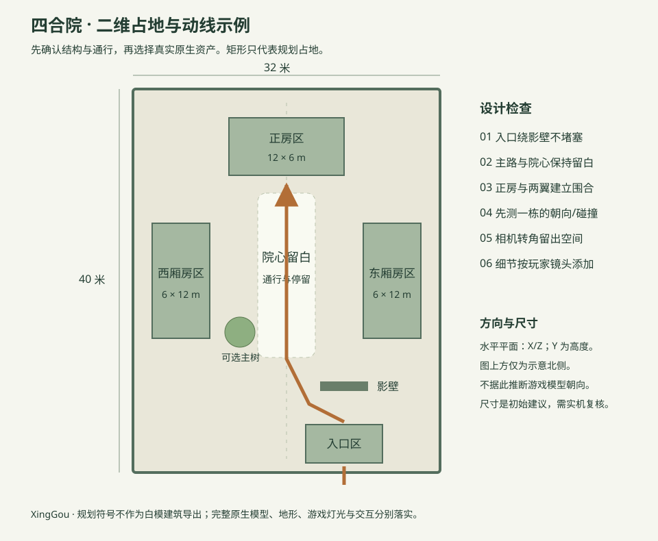

# 星构使用教程：从想法到可玩的关卡

适用 XingGou / 星构工具箱。推荐按“需求 → 概念 → 二维平面 → 主体与通行 → 地形 → 程序规则 → 远中近造景 → 氛围 → 性能实机”推进。地形、镜头、灯光和性能要边做边复核；这是一条可迭代的制作流程，不是完成一个步骤后永不回头。

**第一次使用**：完整解压工具包，双击“启动星构.cmd”。先用现成模型搭一个能走通的小区域，再扩大关卡。网页顶部“地编教程”提供需求卡、AI 提问、阶段清单和可复制的协作指令。

## 1. 先确定玩家要体验什么

让 AI 每轮问 2–3 个关键问题，已经说过的直接沿用。例如：

> 我想做一个四合院。请先了解我要做的游戏类型、玩家视角和游玩目标，再做概念拆解与二维平面。平面确认后再搭建，不要直接生成一堆模型。

首轮先问：这是探索、解谜、战斗、社交还是纯展示？玩家从第一人称、第三人称还是俯视观察？要在院里完成什么、从哪里进入和离开？下一轮再补人数、时长、占地、主题、必须保留的内容、目标设备和负载目标。不懂尺寸时，请 AI 提两个规模方案，确认后再执行。

有参考图就先给支持看图的外部 AI：说明主要借用布局、风格、配色还是镜头；让 AI 列出可见结构与无法确定的部分。本机兼容接口目前发送文字，不会接收本页上传图片或自动把图片变成模型。可将外部 AI 的看图分析填到需求卡“参考图或描述”。无参考图也可以用文字继续。

需求卡至少包含：类型、视角、主题、核心交互或纯展示目的、人数/时长/占地。不要让 AI 在这些未定时擅自加敌人、机关和任务。AI 的完整工作约束见[协作规范](AI地编协作规范.md)。

在内置教程中，需求确认后勾选“需求分析”完成，再点“采用需求，送到设计助手”。网页 AI 助手会采用这张需求卡。二维平面需要自己或外部 AI 制作并确认，在“二维平面规划”阶段勾选完成后重新采用需求，再回设计助手生成三维布局。阶段勾选由用户完成，不表示软件已自动替你制作或验收。

## 2. 把概念拆成可以执行的内容

把概念分别拆成四类，不要直接变成物件数量：

| 清单 | 四合院示例 | 要解决的问题 |
| --- | --- | --- |
| 功能 | 入院、游览、停留、寻找线索或展示 | 玩家为什么来到这里？ |
| 视觉 | 围合、轴线、院落留白、屋檐轮廓 | 什么让人认出这是院落？ |
| 结构 | 正房、东西厢房、入口、影壁、主路 | 哪些占地与高度必须先确定？ |
| 资产 | 现成房屋、门楼、墙、石路、树、灯具 | 库里有哪些可导出的完整原生模型？ |

先搜索真实资产，区分必须、可替代、可选与缺项。若库里的房屋风格不能准确对应传统四合院，应说明是“按院落空间关系搭建的千星风格版本”，不能把任意四间小屋称为精确复原。没有现成资源时列出缺项，不自动拼白模。

## 3. 先画二维平面，再开三维搭建

二维平面至少标：边界和尺寸、入口出口、建筑占地、主次路线、目标点、镜头/视线、禁布区，以及需要高差的位置。给出两个有区别的方案，如“严格中轴的展示院落”和“带绕行路线的探索院落”，先选空间关系，再选细节。

星构的水平平面是 **X/Z**，Y 表示高度。点击编辑器“俯视”可检查分区与间距。示意图的方向标记不代表已验证游戏朝向，不要再手动镜像或全局转 180°。

这张图只是 **32×40 米的起始方案**，不是建筑规范或游戏碰撞标准。门洞宽度、角色尺度、相机转弯与房屋可进入性要到千星实机测试。[四合院完整案例](四合院示例.md)给出了需求卡、占地与分阶段任务。

**确认点**：用户认可平面、入口、动线、主体关系及主要尺度后，再让 AI 写入场景。

## 4. 主体搭建：先少量，先走得通

在资产库搜索完整原生模型，双击添加或拖入画布。W/E/R 切换移动/旋转/缩放，F 聚焦；右键转视角、中键平移、滚轮缩放。Shift 多选，Ctrl+D 复制，Ctrl+Z 撤销。

先放入口、主建筑、两翼与路线。先测一栋建筑的正面、脚点、门洞、碰撞与尺度，再复制其余建筑。不要看到外观像门就假定玩家可以穿过。组合便于编辑，但导出会展开为独立静态单位。

用“保存工程”下载一个主体版本。导出少量 GIA 到千星，按玩家镜头走一遍：出生点能否理解目标，路线是否堵塞，拐角是否卡相机，交互点是否够空。主体有问题时先改结构，暂不堆小物件。

传统流程里的 blockout 用于验证空间。星构以少量完整原生模型进行粗布局；二维图上的矩形是规划符号，不需要在成品里把现成建筑用大量白模重造。

## 5. 地形塑造：在原生编辑器落实

概念阶段就确定大高差，主体阶段验证坡路和视线；随后在千星原生地形工具里完成地面、坡地、河道与边界。星构当前不直接雕刻游戏地形。

记录建筑脚点、路面高度、坡顶/坡底衔接和水位。不要移动已有工程的地面基准来“自动修复”高差。深河道要挖地形；浅水预览不能证明游戏水效果。地形改变后重新检查建筑是否悬空或埋地。

## 6. 程序化布置：把规则写清楚

让 AI 先交规则再执行，例如：

> 种子固定为 42。只用已确认的三种原生树和两种岩石；入口、影壁绕行和中央通路禁止放树。两株树保持建议间距，靠墙成组，不把装饰填满院心。先布一个角落给我看，再扩到全院。

规则要包含：真实资产白名单、种子、分区、密度、最小间距、尺度变化、朝向、边界、禁区、数量上限和预期留白。间距数值是初始建议，必须用实际包围盒和玩法空间复核。

内置“离线布局”无需密钥，支持现有村庄、营地、遗迹、集市等规则，**不是通用四合院生成器或地形算法**。复杂院落应由外部 AI 按已确认平面通过 MCP 布置，或手动搭建。AI 接口可生成坐标，但同样要检索真实模型并检查结构。

## 7. 填充资产：远景、中景、近景

| 景别 | 作用 | 院落示例 |
| --- | --- | --- |
| 远景 | 定边界、轮廓、方向与世界关系 | 院墙外树冠、屋脊、远山轮廓；优先保持简洁 |
| 中景 | 建立可游玩的主体与地标 | 正房、厢房、影壁、主树、主路 |
| 近景 | 叙事、停留与细节 | 门前灯具、盆栽、生活物件；重点放在玩家看得到的地方 |

景别以玩家实际镜头判断。第一人称重视近距离接缝与遮挡，第三人称要留相机空间，俯视更重视角色/障碍/目标对比。避免从编辑器高空视角觉得“空”，就把可玩空间铺满。

做资产预算表，记录每层的模型数量与用途。植物可成组、密度有变化，主地标附近留白。只有找不到匹配的完整原生资源且用户明确同意时，才用基元补充特殊造型。

## 8. 氛围打光：先方向，后细化

在概念阶段确定时间、天气与情绪；后期围绕玩家焦点细化主光方向、冷暖关系、明暗层次和少量灯具。先看剪影与目标是否清楚，再加装饰光。

星构网页的光照是查看模型的预览环境，导出的 GIA 不会把这些网页灯光写入游戏。灯具模型也不必然有真实发光行为。按千星实际提供的环境/灯光设置完成，分别检查白天、夜间、遮蔽区和玩家镜头。

## 9. 性能优化与实机验收

性能预算贯穿制作，而不是最后删光模型。先做小样，固定镜头和同一个负载测试区，再逐批添加建筑、植被、灯具和细节，记录每次读数。优先处理实测开销大、遮挡严重或重复过密的部分。

固定布景保持默认独立静态单位。不要为整体移动而改成动态父实体，也不要把关闭必要碰撞、减少功能或移动到不同测试区当作同等条件优化。物件数、三角面数、模型文件大小都不能替代官方区域负载；记录计算与内存读数，以及测试场景和最差镜头。

导出前检查未绑定编号、缺失模型、穿插、悬空、缩放和备份。把 `.gia` 放进游戏的 `Beyond_Local_Export` 目录，再通过“资产导入导出管理 → 加载外部资产”导入。小批量确认后再导入完整场景。交互节点、胜负逻辑、角色/机关行为需在千星另行制作。

最终交付需求卡、平面图、工程、GIA/GLB、资产缺项、原生地形/灯光/交互待办、实机截图和负载记录。GLB 可在 Blender 继续编辑，不能据此声称新的任意模型可以上传为千星模板。

## 给外部 AI 的一句开场白

> 请按星构《AI地编协作规范》帮我设计关卡。先调用 level_design_guide，读取已有工程，复用我已给的信息；每轮问 2–3 个关键问题。先需求与概念，再做带尺寸和动线的二维平面。等我确认平面再搭主体，使用完整原生资产。地形、交互、游戏灯光与官方负载标为原生编辑器任务。不要一上来直接生成整场景。

外部客户端需先接入 `mcp_server.py`；旧版客户端没有新工具时，把[协作规范](AI地编协作规范.md)全文贴进对话也能采用同样流程。网页内 AI 使用设置中的兼容接口；选择“离线问题清单”不会发送模型请求。

## 方法参考与适用边界

本教程结合星构现有能力，采用先验证尺度和玩法、再细化环境的常见制作思路，参考 [Epic 的关卡 Blockout 教程](https://dev.epicgames.com/documentation/en-us/unreal-engine/designer-01-project-setup-and-level-blockout-in-unreal-engine)与 [Unity 环境美术学习项目](https://learn.unity.com/project/high-fidelity-game-visuals-environment)。它不是千星官方规范；其他引擎的地形、光照、遮挡或性能功能不因此成为星构能力。
